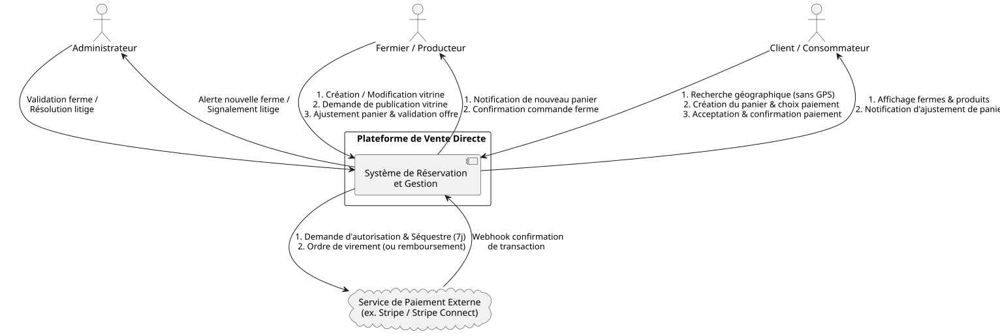
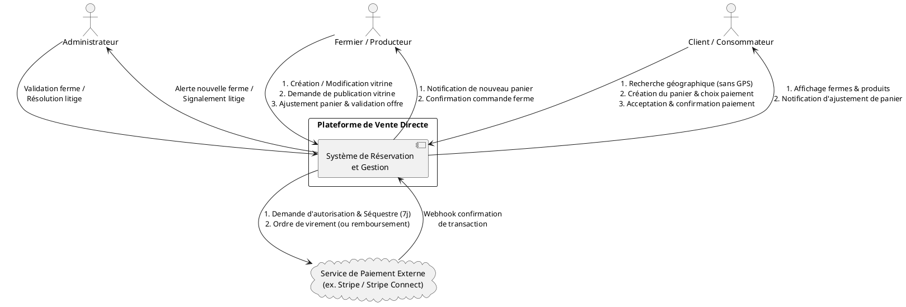
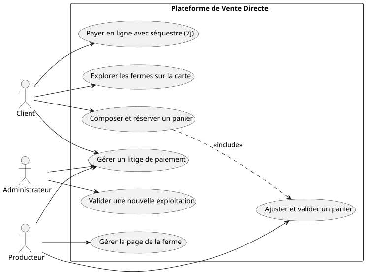
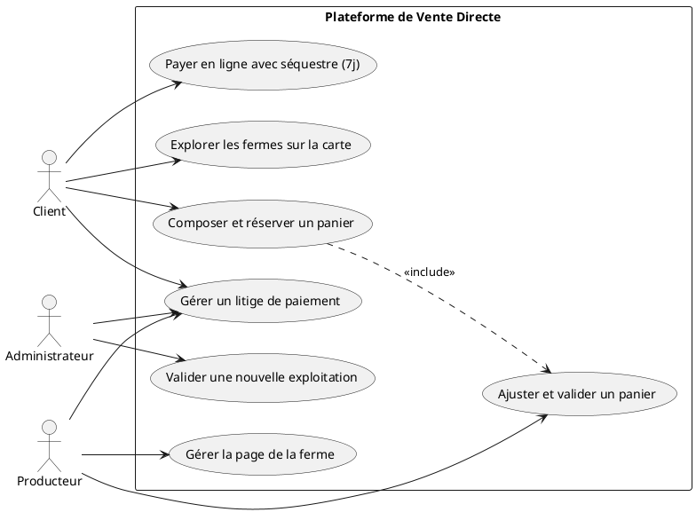
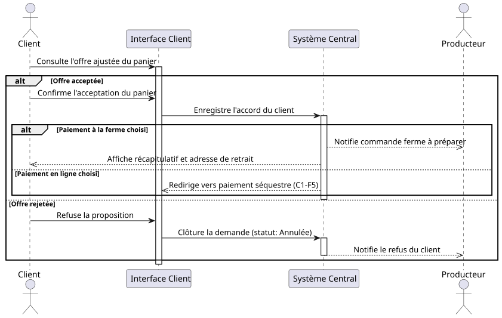
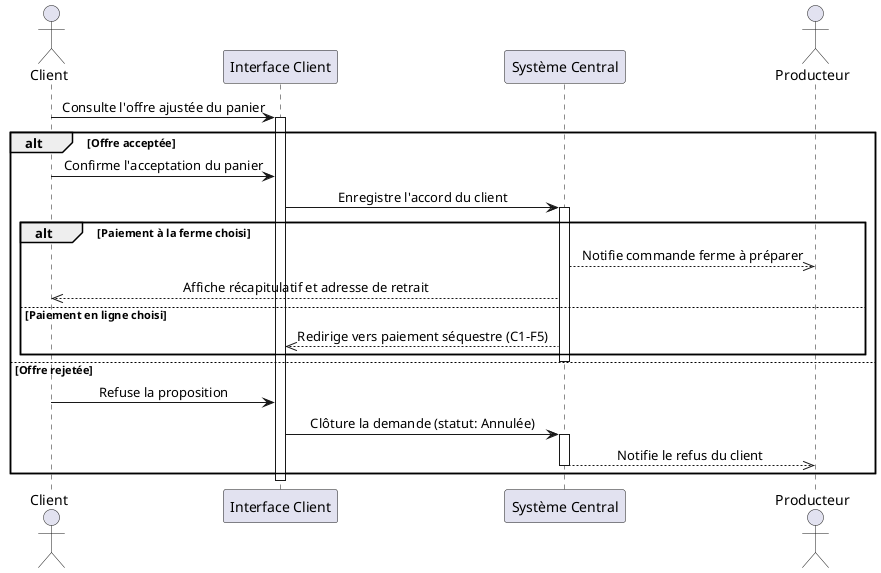
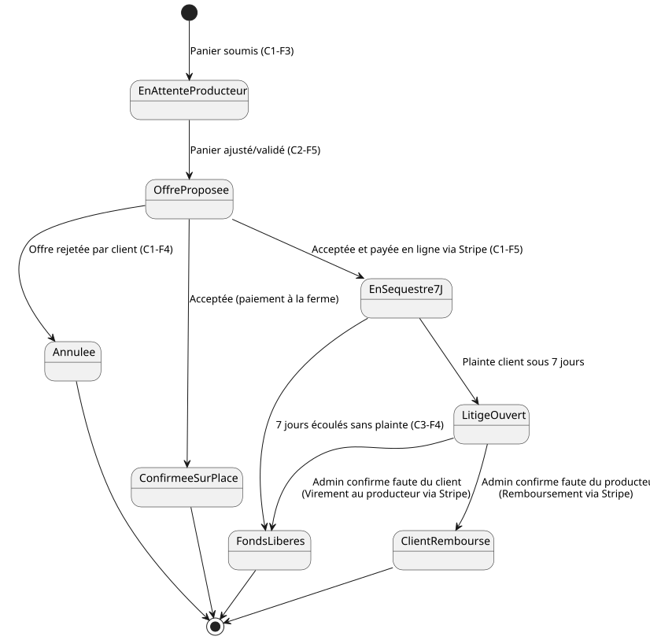
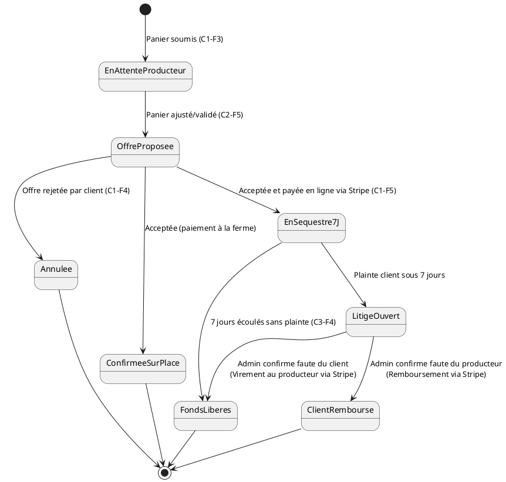
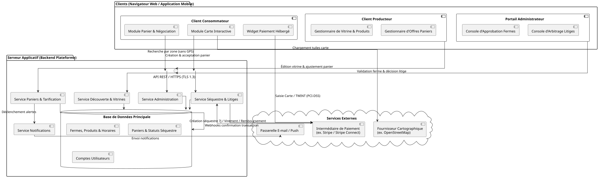
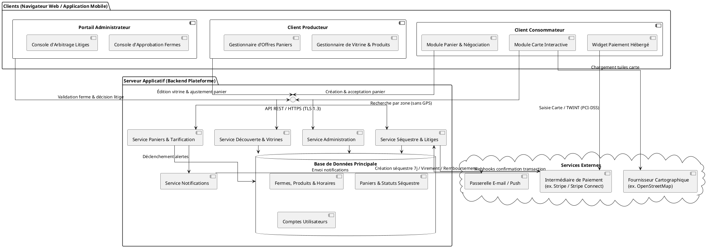

# Project name

| Classification | |
| --- | --- |
| Status | WIP |
| Program name | |
| Project number | |
| Project manager | Project manager |
| Version | 0.1 |
| Date | Click here to enter a date |
| Project sponsor | Project sponsor |
| Author(s) | Han Kieu, Léonard Clément |
| Distribution | |
| List of changes | |

| Version | Date | Change | Author |
| --- | --- | --- | --- |
| 0.1 | | Template revision for Assignment 1 | |

Generate the diagrams with `plantuml -tsvg REQUIREMENTS.md`.

## 1. Project Goal or Product Vision

**FOR (Pour) :** Les consommateurs souhaitant acheter des produits frais en circuit court et les producteurs agricoles locaux pratiquant la vente directe à la ferme,

**WHO (Qui) :** Ont besoin d'un moyen simple et fiable pour localiser les exploitations à proximité et sécuriser les commandes à retirer sur place sans lourdeur logistique,

**THE (La plateforme) :** **[Nom de votre plateforme]** est une application de découverte et de réservation de paniers producteurs locaux,

**THAT (Qui) :** Permet aux clients de repérer les fermes sur une carte interactive respectueuse de leur vie privée et de composer un panier ajustable par le producteur avant validation, tout en offrant le choix entre un paiement libre à la ferme (sans frais) ou un paiement garanti par la plateforme (avec séquestre de 7 jours),

**UNLIKE (Contrairement à) :** Aux plateformes de e-commerce classiques (rigides sur les stocks et coûteuses en commissions) ou aux simples annuaires statiques qui ne permettent ni réservation ni garantie de paiement,

**OUR SOLUTION (Notre solution) :** Combine la souplesse d'une négociation directe sur la disponibilité des produits frais avec une vitrine personnalisable clé en main pour le producteur et une protection transactionnelle optionnelle.

## 2. Users and Scenarios

### 2.1. Personas

Les utilisateurs du système se répartissent en trois groupes distincts : les consommateurs, les producteurs agricoles (producteurs) et les administrateurs de la plateforme.

#### 2.1.1. Clara Meylan — La consommatrice locale soucieuse de sa vie privée (Client)

**Profil :** 34 ans, architecte à Fribourg, adepte de l'alimentation durable et des circuits courts.

**Contexte et activités :** Souhaite acheter des produits frais directement auprès des fermes de sa région le week-end, mais hésite souvent à se déplacer sans garantie sur les produits disponibles ou les horaires réels.

**Objectifs :** Repérer facilement les exploitations agricoles sur une carte, réserver un panier personnalisé à l'avance et choisir un mode de paiement adapté (paiement sécurisé en ligne ou règlement direct sur place).

**Besoins et contraintes :** Refuse de partager sa position GPS en continu ou d'enregistrer son adresse personnelle dans l'application. A besoin d'une confirmation claire avant de prendre la route et d'une garantie financière lorsqu'elle paie à l'avance.

#### 2. Marc Rochat — Le maraîcher et producteur polyvalent (Producteur)

**Profil :** 48 ans, exploitant agricole dans le canton de Fribourg (légumes de saison, œufs, fromages).

**Contexte et activités :** Passe la majorité de son temps aux champs et à la production ; il dispose de peu de temps pour l'administration numérique et ne tient pas d'inventaire informatique précis au quotidien.

**Objectifs :** Disposer d'une vitrine numérique simple et autonome pour présenter sa ferme, recevoir des commandes de paniers à préparer et sécuriser ses ventes contre les désistements.

**Besoins et contraintes :** Ne veut pas gérer de quantités de stock sur la plateforme. A besoin de pouvoir retirer un article manquant d'un panier demandé par un client avant de s'engager, et souhaite pouvoir choisir librement entre encaisser ses clients sur place sans frais (Cash, Carte, TWINT) ou utiliser le paiement garanti de la plateforme.

#### 3. Sophie Baumann — La coordinatrice des opérations (Administratrice)

**Profil :** 29 ans, membre de l'équipe de gestion de la plateforme.

**Contexte et activités :** Assure la fiabilité du catalogue des producteurs référencés et intervient comme tiers de confiance en cas d'incident signalé par e-mail ou téléphone.

**Objectifs :** Vérifier l'authenticité des nouvelles exploitations avant leur publication sur la carte et résoudre équitablement les litiges financiers durant la fenêtre de séquestre de 7 jours.

**Besoins et contraintes :** Ne doit pas être sollicitée pour chaque modification courante effectuée par un producteur déjà approuvé (ajout d'un produit, changement d'horaire). A besoin d'un mécanisme administratif clair pour déclencher un remboursement au client ou libérer les fonds au producteur après examen d'une plainte.

### 2.2. Scenarios

*Describe realistic situations in which a persona uses the system to achieve a goal. Link the scenarios to the requirements.*

#### Scénario 1

Création, validation initiale et mise à jour d'une page ferme (Marc et Sophie) Marc s'inscrit sur la plateforme et configure la vitrine de son exploitation en renseignant sa bannière photo, une description, ses horaires d'ouverture, l'adresse obligatoire de la ferme ainsi que sa liste de produits disponibles (sans saisie de stock) (C2-F1). Il active également ses moyens de paiement autorisés : le paiement en ligne via la plateforme et le paiement sur place par TWINT ou espèces (C2-F2). Une fois enregistrée, sa page reste masquée du public (C2-F3). Sophie reçoit une alerte, vérifie l'existence de l'exploitation et approuve manuellement la page, qui devient immédiatement visible sur la carte (C2-F3). Deux semaines plus tard, Marc ajoute des fraises à sa liste et ajuste ses horaires d'été : ces modifications sont publiées instantanément sans nécessiter de nouvelle validation administrative (C2-F4)

#### Scénario 2

Recherche respectueuse de la vie privée et négociation d'un panier (Clara et Marc) Souhaitant préparer un repas local, Clara ouvre l'application et explore manuellement la carte interactive autour de Fribourg, sans qu'aucune donnée GPS ni adresse personnelle ne soit collectée ou stockée (C1-F1, C1-NF1). Elle sélectionne la ferme de Marc, consulte sa fiche (C1-F2) et compose un panier contenant des tomates, du fromage et un pot de miel, en optant pour le paiement en ligne garanti (C1-F3). Marc reçoit une notification (C3-F1). Constatant qu'il n'a plus de miel disponible, il retire cet article du panier et valide le prix ajusté proposé automatiquement par la plateforme, incluant la commission fixe (C2-F5). Clara est notifiée de cette contre-offre (C3-F2), l'accepte et procède au paiement en ligne (C1-F4, C1-F5). Le montant est placé en séquestre pour 7 jours, la commande devient ferme et non annulable, et Marc prépare le panier (C1-F5)

#### Scénario 3

Réservation avec paiement direct à la ferme sans frais (Clara) Clara repère un second producteur proposant des pommes et du cidre, mais n'acceptant que le paiement à la ferme (Carte, TWINT ou Cash). Elle compose son panier et sélectionne le paiement sur place (C1-F3). Le producteur valide le panier sans modification (C2-F5) et Clara confirme la commande (C1-F4). Aucune commission n'est prélevée et aucune garantie financière n'est appliquée par la plateforme (C1-F6). Clara se rend à la ferme aux horaires indiqués et règle directement le producteur lors du retrait

#### Scénario 4

Gestion d'un litige durant la période de séquestre de 7 jours (Clara, Marc et Sophie) Dans le cadre d'une commande payée en ligne sur la plateforme, Clara se présente à la ferme aux horaires convenus mais trouve le point de vente fermé et injoignable. Dans le délai de 7 jours suivant son paiement, elle contacte l'administration via l'e-mail ou le numéro de support indiqué sur la plateforme pour déposer une plainte (C1-F7). Sophie instruit manuellement le dossier auprès des deux parties : constatant que le producteur n'a pas permis à la cliente de récupérer son panier comme promis, elle clôture le litige en déclenchant le remboursement intégral de Clara (C3-F3). (À l'inverse, si l'enquête montrait que Marc était présent et disponible mais que Clara avait omis de venir chercher sa commande non annulable, Sophie aurait libéré l'intégralité du paiement en faveur de Marc.)

## 3. System Overview

### 3.1. Information Flow Diagram

*Show the principal information exchanges between users, the system and external services. Explain the important flows.*

### 3.2. Use Case Diagram(s)

*Show the main system functionality with an overview Use Case Diagram. This is a deliberately small example; actual project diagrams may contain more actors, use cases and relationships. Detailed use cases related to individual requirements belong in Section 4.*

## 4. Detailed Requirements

*Group functional and non-functional requirements into categories. For Assignment 1, specify at least 15 functional requirements in three categories and at least five non-functional requirements in two or more categories. The few examples below illustrate formats, not the required quantity.*

### 4.1. Functional Requirements

*Each requirement must include an ID, name and short description. Specify complex requirements in more detail using suitable textual fields from lecture L5 or established standards, and models where appropriate. Models may relate to one requirement or several requirements within a category; do not duplicate their content in text.*

#### 4.1.1. Catégorie 1 - Découverte des fermes et commande de paniers (Client)

**Description de la catégorie :** Les consommateurs explorent les exploitations agricoles sur une carte, consultent leurs produits et composent des paniers à retirer à la ferme.

##### Exigence C1-F1 - Exploration des fermes sur la carte interactive

| **ID** | `C1-F1` |
| --- | --- |
| **Name** | Exploration des fermes sur la carte interactive |
| **Short description** | Le système affiche une carte interactive permettant à tout visiteur (sans compte requis) de repérer les fermes approuvées dans la zone géographique affichée. |

##### Exigence C1-F2 - Consultation de la vitrine d'une ferme

| **ID** | `C1-F2` |
| --- | --- |
| **Name** | Consultation de la vitrine d'une ferme |
| **Short description** | Le système affiche la page publique d'une ferme comprenant sa bannière photo, sa description, ses horaires d'ouverture, son adresse obligatoire, la liste des produits proposés et les moyens de paiement acceptés. |

##### Exigence C1-F3 - Composition d'un panier et sélection du mode de paiement

| **ID** | `C1-F3` |
| --- | --- |
| **Name** | Composition d'un panier et sélection du mode de paiement |
| **Short description** | Un client authentifié compose un panier à partir des produits d'une ferme et choisit l'un des moyens de paiement autorisés par ce producteur. |
| **Inputs** | Identifiant de la ferme, liste des produits sélectionnés avec quantités souhaitées, mode de paiement choisi (paiement en ligne sur la plateforme ou paiement à la ferme : Carte, TWINT, Cash). |
| **Preconditions** | Le client est connecté à son compte ; la page de la ferme est approuvée et visible ; le panier contient au moins un article. |
| **Rules / steps** | 1. Le système vérifie que tous les produits proviennent d'une seule et même ferme. 2. Le système restreint le choix du paiement aux options activées par le producteur (`C2-F2`). 3. Le système enregistre la demande avec le statut *"En attente de validation producteur"* et déclenche une notification (`C3-F2`). |
| **Outputs** | Identifiant de demande de panier et estimation indicative du montant total. |
| **Acceptance criteria** | Un panier valide est enregistré en base de données et transmis au producteur concerné ; toute tentative de soumettre un panier vide ou avec un mode de paiement non autorisé par la ferme est rejetée. |

##### Exigence C1-F4 - Acceptation ou refus de l'offre ajustée du producteur

| **ID** | `C1-F4` |
| --- | --- |
| **Name** | Acceptation ou refus de l'offre ajustée du producteur |
| **Short description** | Le client examine le panier validé ou modifié par le producteur ainsi que le prix final proposé, puis décide d'accepter ou de rejeter l'offre. |
| **Rules / constraints** | L'acceptation d'une offre engage fermement le client à retirer son panier ; aucune annulation unilatérale n'est autorisée après confirmation. |
| **Acceptance criteria** | Si le client rejette l'offre, la demande passe au statut *"Annulée"* sans frais ; s'il l'accepte avec paiement sur place, la commande passe au statut *"Confirmée"* ; s'il l'accepte avec paiement en ligne, le flux de séquestre (`C1-F5`) est déclenché. |
| **Model** |  |

##### Exigence C1-F5 - Paiement en ligne sécurisé avec séquestre de 7 jours

| **ID** | `C1-F5` |
| --- | --- |
| **Name** | Paiement en ligne sécurisé avec sequester de 7 jours |
| **Short description** | Lorsque le client opte pour le paiement en ligne et accepte l'offre, il règle le montant majoré de la commission fixe via le module hébergé de l'intermédiaire de paiement externe (ex. : Stripe), qui conserve les fonds en séquestre pendant 7 jours. |
| **Inputs** | Identifiant du panier accepté, montant total incluant la commission fixe (`C3-F3`), jeton et confirmation (webhook) retournés par l'intermédiaire de paiement. |
| **Preconditions** | Le producteur a activé le paiement en ligne avec un compte bénéficiaire valide (`C2-F2`) et validé l'offre (`C2-F5`) ; le client a accepté l'offre (`C1-F4`). |
| **Rules / steps** | 1. Le système crée une intention de paiement auprès de l'API de l'intermédiaire externe avec rétention des fonds (séquestre / transfert différé de 7 jours). 2. Le client saisit ses données de paiement (Carte ou TWINT) exclusivement sur l'interface sécurisée du prestataire. 3. À réception de la confirmation du prestataire, la commande devient ferme et non annulable : le producteur doit préparer le panier et le client doit venir le retirer. |
| **Outputs** | Identifiant de transaction externe, reçu de paiement, date d'expiration du séquestre ($T_0 + 7\text{ jours}$) et coordonnées de support visibles en cas de litige. |
| **Acceptance criteria** | Dès réception de la confirmation de l'intermédiaire de paiement, le statut de la commande passe à *"En séquestre (7j)"*, aucune donnée bancaire n'est stockée sur la plateforme, aucun bouton d'annulation n'est disponible et le producteur reçoit l'ordre de préparation. |

#### 4.1.2. Catégorie 2 - Gestion de la vitrine et traitement des paniers (Producteur)

**Description de la catégorie :** Les producteurs agricoles créent leur vitrine, définissent leurs conditions de vente et ajustent les demandes de paniers selon leurs disponibilités réelles.

##### Exigence C2-F1 - Création initiale de la vitrine d'exploitation

| **ID** | `C2-F1` |
| --- | --- |
| **Name** | Création initiale de la vitrine d'exploitation |
| **Short description** | Un producteur inscrit crée sa page ferme en saisissant obligatoirement l'adresse physique de l'exploitation, une bannière photo, une description et ses horaires d'ouverture ; la page reste masquée du public jusqu'à validation administrative (`C3-F1`). |

##### Exigence C2-F2 - Configuration des moyens de paiement autorisés

| **ID** | `C2-F2` |
| --- | --- |
| **Name** | Configuration des moyens de paiement autorisés |
| **Short description** | Le producteur sélectionne les modalités de règlement qu'il accepte : paiement en ligne délégué via l'intermédiaire de paiement de la plateforme (nécessitant l'association d'un compte bénéficiaire auprès du prestataire, tel que Stripe Connect, avec garantie et commission fixe) et/ou paiement direct à la ferme (Carte, TWINT, Cash, sans frais ni garantie). |

##### Exigence C2-F3 - Gestion du catalogue de produits sans suivi de stock

| **ID** | `C2-F3` |
| --- | --- |
| **Name** | Gestion du catalogue de produits sans suivi de stock |
| **Short description** | Le producteur ajoute, modifie ou supprime des produits disponibles (nom, unité, prix unitaire) sur sa vitrine à tout moment, sans jamais avoir à saisir ou maintenir de quantités en stock. |

##### Exigence C2-F4 - Publication immédiate des modifications d'une vitrine approuvée

| **ID** | `C2-F4` |
| --- | --- |
| **Name** | Publication immédiate des modifications d'une vitrine approuvée |
| **Short description** | Toute mise à jour apportée par un producteur à une page déjà validée par l'administration est publiée instantanément sans nouvelle approbation manuelle. |
| **Inputs** | Modifications de la bannière photo, de la description, des horaires d'ouverture, de la liste des produits ou des moyens de paiement. |
| **Preconditions** | Le compte du producteur est authentifié et sa vitrine possède déjà le statut *"Approuvée"*. |
| **Rules / steps** | 1. Le système valide le format des champs modifiés (ex. : adresse non vide, prix positifs). 2. Le système enregistre les nouvelles données et conserve le statut *"Approuvée"*. 3. La vitrine reste visible sur la carte sans interruption. |
| **Outputs** | Confirmation d'enregistrement et mise à jour immédiate de la page publique de la ferme. |
| **Acceptance criteria** | Lorsqu'un producteur approuvé modifie ses horaires ou ajoute un produit, le changement est visible par un visiteur en moins de 5 secondes sans intervention d'un administrateur. |

##### Exigence C2-F5 - Ajustement d'un panier et validation de l'offre

| **ID** | `C2-F5` |
| --- | --- |
| **Name** | Ajustement d'un panier et validation de l'offre |
| **Short description** | À réception d'une demande de panier, le producteur peut retirer les articles indisponibles et valider le prix final proposé automatiquement par la plateforme. |
| **Inputs** | Identifiant de la demande de panier, liste des articles conservés (suppression possible des articles manquants), confirmation du prix calculé. |
| **Preconditions** | Une demande de panier au statut *"En attente de validation producteur"* existe pour cette exploitation. |
| **Rules / steps** | 1. Le producteur consulte le panier demandé et retire, le cas échéant, un ou plusieurs produits indisponibles. 2. Le système recalcule automatiquement le prix total en fonction des articles conservés et du mode de paiement choisi (`C3-F3`). 3. Le producteur valide cette proposition, ce qui fait passer la demande au statut *"Offre soumise au client"* et notifie l'acheteur (`C3-F2`). |
| **Outputs** | Panier mis à jour, prix final validé et notification envoyée au client. |
| **Acceptance criteria** | Le producteur peut supprimer un article manquant d'un panier demandé, voir le prix ajusté se recalculer automatiquement et transmettre l'offre au client ; si tous les articles sont retirés, la demande est refuse. |

#### 4.1.3. Catégorie 3 - Administration, notifications et gestion financière (Système & Admin)

**Description de la catégorie :** Le système automatise les notifications et le calcul des commissions, tandis que l’administrateur contrôle l’entrée des producteurs et arbitre les litiges.

##### Exigence C3-F1 - Approbation manuelle d’une nouvelle ferme

| ID | `C3-F1` |
| :---: | :--- |
| **Name** | Approbation manuelle d’une nouvelle ferme |
| **Short**      description | Un administrateur examine les nouvelles pages fermes créées et valide manuellement leur publication pour les rendre visibles sur la carte. |
| **Inputs** | Identifiant de la ferme en attente, décision de l’administrateur (Approuver ou Rejeter). |
| **Preconditions** | Un producteur a finalisé la création initiale de sa vitrine (C2-F1),  qui se trouve au statut "En attente d’approbation" (masquée du public). |
| **Rules / steps** | 1. L’administrateur vérifie l’authenticité de l’exploitation et la validité de l’adresse saisie. 2 Si l’administrateur approuve la page, son statut passe à *"Approuvée"* et ses coordonnées géographiques apparaissent immédiatement sur la carte publique (`C1-F1`).  3. En cas de rejet, la vitrine reste masquée et le producteur est informé du motif. |
| **Outputs** | Mise à jour de la visibilité de la ferme sur la plateforme. |
| **Acceptance criteria** | Une ferme nouvellement créée est invisible dans les recherches clients avant validation et devient consultable publiquement dès qu’un administrateur clique sur *"Approuver"*. |

##### Exigence C3-F2 - Notification des événements de commande

| ID | `C3-F2` |
| :---: | :--- |
| **Name** | Notification des événements de commande |
| **Short description** | Le système envoie automatiquement une notification au producteur lorsqu’un client crée un panier, puis au client lorsque le producteur valide ou ajuste ce panier. |

##### Exigence C3-F3 - Calcul automatique du prix et de la commission fixe

| ID | `C3-F3` |
| :---: | :--- |
| **Name** | Calcul  automatique du prix et de la commission fixe |
| **Short description** | Le système calcule automatiquement le prix du panier à partir des produits retenus en appliquant un taux de commission fixe uniquement lorsque le paiement en ligne est sélectionné. |
| **Inputs** | Liste des produits retenus avec leurs prix unitaires, mode de paiement  choisi, taux de commission fixe paramétré sur la plateforme. |
| **Rules / steps** | 1. Le système calcule le sous-total des produits $S = \sum (\text{prix}_i \times \text{quantité}_i)$. 2. Si le mode de paiement est *"Paiement à la ferme"*, le montant final est égal à $S$ (commission $= 0$). 3. Si le mode de paiement est *"Paiement en ligne"*, le montant final facturé au client est $M = S \times (1 + r)$, la part reversée au producteur étant $S$. |
| **Outputs** | Sous-total producteur ($S$), montant de la commission et prix total client ($M$). |
| **Acceptance criteria** | Pour un panier de 50 CHF et un taux fixe de 10 %, le système affiche 50 CHF sans frais pour un paiement sur place et 55 CHF pour un paiement en ligne. |

##### Exigence C3-F4 - Libération automatique des fonds en séquestre après 7 jours

| ID | `C3-F4` |
| :---: | :--- |
| **Name** | Libération automatique des fonds en séquestre après 7 jours |
| **Short description** | Si aucun litige n'est ouvert dans les 7 jours calendaires suivant un paiement en ligne, le système envoie automatiquement via l'API de l'intermédiaire de paiement l'instruction de transférer la part du producteur ($S$) vers son compte bénéficiaire et de prélever la commission fixe de la plateforme. |

##### Exigence C3-F5 - Arbitrage manuel d’un litige de transaction

| ID | `C3-F5` |
| :---: | :--- |
| **Name** | Arbitrage manuel d’un litige de transaction |
| **Short description** | Lorsqu'un client signale par e-mail ou téléphone (via les coordonnées affichées sur la plateforme) ne pas avoir pu obtenir son panier payé en ligne dans le délai de 7 jours, l'administrateur suspend le transfert automatique et tranche le litige via l'intermédiaire de paiement. |
| **Rules / constraints** | L'administrateur ne peut clôturer un litige que selon deux issues exclusives exécutées via l'API de l'intermédiaire de paiement : (1) ordre de remboursement intégral du client si le producteur n'a pas fourni le panier comme promis, ou (2) ordre de libération des fonds au producteur si le client ne s'est pas présenté alors que le producteur a rempli ses obligations. |
| **Acceptance criteria** | L'ouverture d'un litige bloque l'envoi de l'instruction automatique de transfert (`C3-F4`) ; l'issue (1) déclenche un remboursement complet auprès du prestataire (statut *"Client remboursé"*), tandis que l'issue (2) déclenche le virement vers le compte bénéficiaire du producteur (statut *"Fonds libérés"*). |
| **Model** |  |

### 4.2. Non-Functional Requirements

Chaque exigence non fonctionnelle précise des critères d’acceptation mesurables accompagnés des conditions de charge ou d’exploitation.

#### 4.2.1. Catégorie 1 - Confidentialité et Sécurité

##### Exigence C1-NF1 - Protection de la vie privée et non-collecte de la géolocalisation client

| ID | `C1-NF1` |
| :---: | :--- |
| **Name** | Protection de la vie privée et non-collecte de la géolocalisation client |
| **Description** | L’application ne doit ni demander l’accès au capteur GPS du terminal client, ni enregistrer d’adresse postale personnelle pour les consommateurs. |
| **Measurable acceptance criterion** | Lors d’un audit des requêtes réseau et du schéma de base de données sur 100 sessions clients complètes (exploration de la carte et  commande), 0 permission GPS n’est sollicitée côté client et 0 donnée de localisation ou adresse personnelle d’acheteur n’est persistée sur les serveurs. |

##### **Exigence C1-NF2 - Sécurisation des paiements en ligne**

| ID | `C1-NF2` |
| :---: | :--- |
| **Name** | Délégation et sécurisation des paiements en ligne |
| **Description** | L'ensemble du traitement des transactions en ligne (carte bancaire, TWINT) ainsi que la rétention temporaire des fonds durant le séquestre de 7 jours doivent être intégralement délégués à un intermédiaire de paiement externe certifié PCI-DSS (tel que Stripe), sans qu'aucune donnée bancaire sensible ne transite en clair ni ne soit stockée sur les serveurs de la plateforme. |
| **Measurable acceptance criterion** | Lors d'un audit technique et réseau portant sur 100 transactions en ligne (Carte et TWINT), 100 % des saisies de paiement s'effectuent via les composants hébergés du prestataire (ex. : Stripe Checkout/Elements), 100 % des échanges réseau utilisent le protocole TLS 1.3 minimum, et 0 donnée financière sensible (numéro de carte, CVV, identifiant bancaire) n'est enregistrée dans la base de données de la plateforme. |

#### 4.2.2. Catégorie 2 - Performance et Fiabilité

##### Exigence C2-NF1 - Temps de réponse de la carte interactive

| ID | `C2-NF1` |
| :---: | :--- |
| **Name** | Temps de réponse de la carte interactive |
| **Description** | L’affichage des fermes approuvées lors du déplacement ou du zoom sur la carte interactive doit s’effectuer rapidement en charge normale. |
| **Measurable acceptance criterion** | Au moins 95 % de 1 000 requêtes de chargement de zone géographique aboutissent en moins de 1,5 seconde avec 200 utilisateurs simultanés sur une base de données contenant 1 000 fermes enregistrées. |

##### Exigence C2-NF2 - Délai d’acheminement des notifications de négociation

| ID | `C2-NF2` |
| :---: | :--- |
| **Name** | Délai d’acheminement des notifications de négociation |
| **Description** | Les notifications lors de la soumission d’un panier ou de l’envoi d’une contre-offre par le fermier doivent être transmises sans délai notable. |
| **Measurable acceptance criterion** | 99 % des notifications (push/e-mail) sont émises par le serveur vers le service de messagerie en moins de 5 secondes après l’action déclenchante, mesuré sur un échantillon de 500 transitions de panier. |

#### 4.2.3. Catégorie 3 - Ergonomie

##### Exigence C3-NF1 - Simplicité de configuration et de mise à jour de vitrine

| ID | `C3-NF1` |
| :---: | :--- |
| **Name** | Simplicité de configuration et de mise à jour de vitrine |
| **Description** | L’interface fermier doit permettre la création d’une vitrine et l’ajustement d’un panier sans formation préalable ni saisie complexe. |
| **Measurable acceptance criterion** | Lors d'un test d'utilisabilité mené auprès de 10 producteurs sans assistance, au moins 90 % d'entre eux parviennent à créer une vitrine complète avec 5 produits en moins de 8 minutes, et à retirer un article d'un panier reçu en moins de 30 secondes. |

## 5. System Architecture

### 5.1. Client–Server Architecture

*Include a diagram of the intended clients, servers and main components. Indicate the principal connections and responsibilities.* *Include a conceptual UML Class Diagram showing main domain classes and their relationships. This is a conceptual model, not an implementation or database diagram.*

