# PanierFermier

| Classification | |
| --- | --- |
| Status | WIP |
| Program name | Requirements Engineering for Information Systems |
| Project number | Assignment 1 |
| Project manager | Han Kieu, Léonard Clément |
| Version | 0.1 |
| Date | 16.11.2026 |
| Project sponsor | |
| Author(s) | Han Kieu, Léonard Clément |
| Distribution | Université de Fribourg |
| List of changes | Initial specifications |

| Version | Date | Change | Author |
| --- | --- | --- | --- |
| 0.1 | 16.11.2026 | Initial requirements submission | Han Kieu, Léonard Clément |

Generate the diagrams with [`plantuml -tsvg REQUIREMENTS.md`](https://plantuml.com/).
Generate the table of contents with [`md_toc --in-place --skip-lines 1 github REQUIREMENTS.md`](https://github.com/frnmst/md-toc).

Project planning: https://tasks.uhrbaan.ch/share/h3w8UJ96AC71giYVGlKsHuYyq5EgftbV9oPa5MPm/auth?view=44

## Table of contents

<!--TOC-->

- [Table of contents](#table-of-contents)
- [1. Project Goal or Product Vision](#1-project-goal-or-product-vision)
- [2. Users and Scenarios](#2-users-and-scenarios)
  - [2.1. Personas](#21-personas)
    - [2.1.1. Clara Meylan — The privacy-conscious local consumer (Client)](#211-clara-meylan--the-privacy-conscious-local-consumer-client)
    - [2.1.2. Marc Rochat — The versatile market gardener and producer (Producer)](#212-marc-rochat--the-versatile-market-gardener-and-producer-producer)
    - [2.1.3. Sophie Baumann — The operations coordinator (Administrator)](#213-sophie-baumann--the-operations-coordinator-administrator)
  - [2.2. Scenarios](#22-scenarios)
    - [Scenario 1](#scenario-1)
    - [Scenario 2](#scenario-2)
    - [Scenario 3](#scenario-3)
    - [Scenario 4](#scenario-4)
- [3. System Overview](#3-system-overview)
  - [3.1. Information Flow Diagram](#31-information-flow-diagram)
  - [3.2. Use Case Diagram(s)](#32-use-case-diagrams)
  - [3.3. Conceptual UML Class Diagram (Domain Model)](#33-conceptual-uml-class-diagram-domain-model)
- [4. Detailed Requirements](#4-detailed-requirements)
  - [4.1. Functional Requirements](#41-functional-requirements)
    - [4.1.1. Category 1 - Farm discovery and basket ordering (Client)](#411-category-1---farm-discovery-and-basket-ordering-client)
      - [C1-F1 - Map exploration](#c1-f1---map-exploration)
      - [C1-F2 - Storefront consultation](#c1-f2---storefront-consultation)
      - [C1-F3 - Basket composition and payment](#c1-f3---basket-composition-and-payment)
      - [C1-F4 - Offer acceptance or refusal](#c1-f4---offer-acceptance-or-refusal)
      - [C1-F5 - Guaranteed online payment](#c1-f5---guaranteed-online-payment)
    - [4.1.2. Category 2 - Storefront management and basket processing (Producer)](#412-category-2---storefront-management-and-basket-processing-producer)
      - [C2-F1 - Storefront creation](#c2-f1---storefront-creation)
      - [C2-F2 - Payment methods](#c2-f2---payment-methods)
      - [C2-F3 - Product catalogue](#c2-f3---product-catalogue)
      - [C2-F4 - Storefront update](#c2-f4---storefront-update)
      - [C2-F5 - Basket adjustment and offer](#c2-f5---basket-adjustment-and-offer)
    - [4.1.3. Category 3 - Administration, notifications and financial management (System & Admin)](#413-category-3---administration-notifications-and-financial-management-system--admin)
      - [C3-F1 - Farm approval](#c3-f1---farm-approval)
      - [C3-F2 - Order notifications](#c3-f2---order-notifications)
      - [C3-F3 - Price and commission calculation](#c3-f3---price-and-commission-calculation)
      - [C3-F4 - 7-day fund release](#c3-f4---7-day-fund-release)
      - [C3-F5 - Dispute arbitration](#c3-f5---dispute-arbitration)
  - [4.2. Non-Functional Requirements](#42-non-functional-requirements)
    - [4.2.1. Category 1 - Privacy and Security](#421-category-1---privacy-and-security)
      - [C1-NF1 - Privacy](#c1-nf1---privacy)
      - [C1-NF2 - Payment security](#c1-nf2---payment-security)
    - [4.2.2. Category 2 - Performance and Reliability](#422-category-2---performance-and-reliability)
      - [C2-NF1 - Map performance](#c2-nf1---map-performance)
      - [C2-NF2 - Notification delay](#c2-nf2---notification-delay)
    - [4.2.3. Category 3 - Ergonomics](#423-category-3---ergonomics)
      - [C3-NF1 - Storefront ergonomics](#c3-nf1---storefront-ergonomics)
- [5. System Architecture](#5-system-architecture)
  - [5.1. Client–Server Architecture](#51-clientserver-architecture)

<!--TOC-->

## 1. Project Goal or Product Vision

**FOR:** Consumers wishing to buy fresh produce through short supply chains, and local agricultural producers practising direct farm sales,

**WHO:** Need a simple and reliable way to locate nearby farms and secure orders to be collected on site without logistical overhead,

**THE:** **PanierFermier** is a local producer basket discovery and reservation application,

**THAT:** Allows clients to locate farms on a privacy-respecting interactive map and to compose a basket that the producer can adjust before confirmation, while offering a choice between fee-free payment at the farm or payment guaranteed by the platform (with a 7-day escrow),

**UNLIKE:** Classic e-commerce platforms (rigid about stock and costly in commissions) or simple static directories that allow neither reservation nor payment guarantee,

**OUR SOLUTION:** Combines the flexibility of a direct negotiation over the availability of fresh produce with a turnkey customisable storefront for the producer and an optional transactional protection.

## 2. Users and Scenarios

### 2.1. Personas

The system's users fall into three distinct groups: consumers, agricultural producers (farmers) and platform administrators.

#### 2.1.1. Clara Meylan — The privacy-conscious local consumer (Client)

**Profile:** 34 years old, architect in Fribourg, committed to sustainable food and short supply chains.

**Context and activities:** Wants to buy fresh produce directly from farms in her region at the weekend, but often hesitates to travel without any guarantee about the products actually available or the real opening hours.

**Objectives:** Easily locate farms on a map, reserve a personalised basket in advance and choose a suitable payment method (secure online payment or direct payment on site).

**Needs and constraints:** Refuses to share her GPS position continuously or to register her personal address in the application. Needs a clear confirmation before setting off, and a financial guarantee when she pays in advance.

#### 2.1.2. Marc Rochat — The versatile market gardener and producer (Producer)

**Profile:** 48 years old, farmer in the canton of Fribourg (seasonal vegetables, eggs, cheeses).

**Context and activities:** Spends most of his time in the fields and on production; he has little time for digital administration and does not keep a precise computerised inventory on a daily basis.

**Objectives:** Have a simple and autonomous digital storefront to present his farm, receive basket orders to prepare, and secure his sales against no-shows.

**Needs and constraints:** Does not want to manage stock quantities on the platform. Needs to be able to remove a missing item from a basket requested by a client before committing, and wishes to choose freely between collecting payment on site without fees (Cash, Card, TWINT) or using the platform's guaranteed payment.

#### 2.1.3. Sophie Baumann — The operations coordinator (Administrator)

**Profile:** 29 years old, member of the platform management team.

**Context and activities:** Ensures the reliability of the catalogue of listed producers and acts as a trusted third party in the event of an incident reported by e-mail or telephone.

**Objectives:** Verify the authenticity of new farms before publishing them on the map, and resolve financial disputes fairly during the 7-day escrow window.

**Needs and constraints:** Must not be solicited for every routine change made by an already approved producer (adding a product, changing opening hours). Needs a clear administrative mechanism to trigger a refund to the client or release the funds to the producer after examining a complaint.

### 2.2. Scenarios

#### Scenario 1

Farm page creation, initial validation and update (Marc and Sophie). Marc registers on the platform and configures his farm's storefront by entering his banner photo, a description, his opening hours, the mandatory farm address as well as his list of available products (without entering any stock) ([C2-F1](#c2-f1---storefront-creation)). He also enables his authorised payment methods: online payment through the platform and on-site payment by TWINT or cash ([C2-F2](#c2-f2---payment-methods)). Once saved, his page remains hidden from the public ([C3-F1](#c3-f1---farm-approval)). Sophie receives an alert, verifies that the farm exists and manually approves the page, which immediately becomes visible on the map ([C3-F1](#c3-f1---farm-approval)). Two weeks later, Marc adds strawberries to his list and adjusts his summer opening hours: these changes are published instantly without requiring a new administrative validation ([C2-F4](#c2-f4---storefront-update)).

#### Scenario 2

Privacy-respecting search and basket negotiation (Clara and Marc). Wishing to prepare a local meal, Clara opens the application and manually explores the interactive map around Fribourg, without any GPS data or personal address being collected or stored ([C1-F1](#c1-f1---map-exploration), [C1-NF1](#c1-nf1---privacy)). She selects Marc's farm, consults its page ([C1-F2](#c1-f2---storefront-consultation)) and composes a basket containing tomatoes, cheese and a jar of honey, opting for the guaranteed online payment ([C1-F3](#c1-f3---basket-composition-and-payment)). Marc receives a notification ([C3-F2](#c3-f2---order-notifications)). Noticing that he no longer has any honey available, he removes that item from the basket and validates the adjusted price automatically proposed by the platform, including the fixed commission ([C2-F5](#c2-f5---basket-adjustment-and-offer)). Clara is notified of this counter-offer ([C3-F2](#c3-f2---order-notifications)), accepts it and proceeds with the online payment ([C1-F4](#c1-f4---offer-acceptance-or-refusal), [C1-F5](#c1-f5---guaranteed-online-payment)). The amount is placed in escrow for 7 days, the order becomes firm and non-cancellable, and Marc prepares the basket ([C1-F5](#c1-f5---guaranteed-online-payment)).

#### Scenario 3

Reservation with fee-free direct payment at the farm (Clara). Clara spots a second producer offering apples and cider, but accepting only payment at the farm (Card, TWINT or Cash). She composes her basket and selects on-site payment ([C1-F3](#c1-f3---basket-composition-and-payment)). The producer validates the basket without modification ([C2-F5](#c2-f5---basket-adjustment-and-offer)) and Clara confirms the order ([C1-F4](#c1-f4---offer-acceptance-or-refusal)). No commission is charged and no financial guarantee is applied by the platform ([C3-F3](#c3-f3---price-and-commission-calculation)). Clara goes to the farm at the indicated hours and pays the producer directly on collection.

#### Scenario 4

Handling a dispute during the 7-day escrow period (Clara, Marc and Sophie). In the context of an order paid online on the platform, Clara arrives at the farm at the agreed hours but finds the point of sale closed and unreachable. Within 7 days of her payment, she contacts the administration through the e-mail address or support number indicated on the platform to file a complaint ([C3-F5](#c3-f5---dispute-arbitration)). Sophie manually investigates the case with both parties: establishing that the producer did not allow the client to collect her basket as promised, she closes the dispute by triggering a full refund to Clara ([C3-F5](#c3-f5---dispute-arbitration)). (Conversely, had the investigation shown that Marc was present and available but Clara had failed to collect her non-cancellable order, Sophie would have released the entire payment in Marc's favour.)

## 3. System Overview

### 3.1. Information Flow Diagram

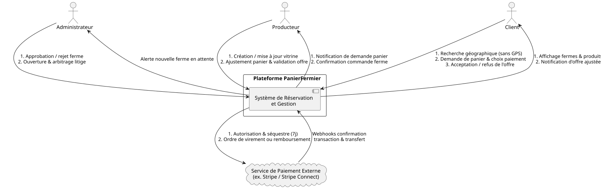

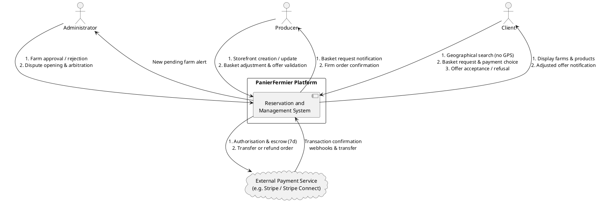

The **Client** queries the map without transmitting any GPS data ([`C1-NF1`](#c1-nf1---privacy)) and submits a basket request to a **Producer**. The latter is notified, adjusts the items according to his real availability and returns a firm offer. If online payment is chosen, the system delegates the transaction and the 7-day retention to the **External Payment Service** (Stripe), which confirms the operation by webhook. The **Administrator** receives an alert only when a new storefront is created and needs validation ([`C3-F1`](#c3-f1---farm-approval)) and intervenes manually on the system when a dispute is reported to her by e-mail or telephone ([`C3-F5`](#c3-f5---dispute-arbitration)).

### 3.2. Use Case Diagram(s)

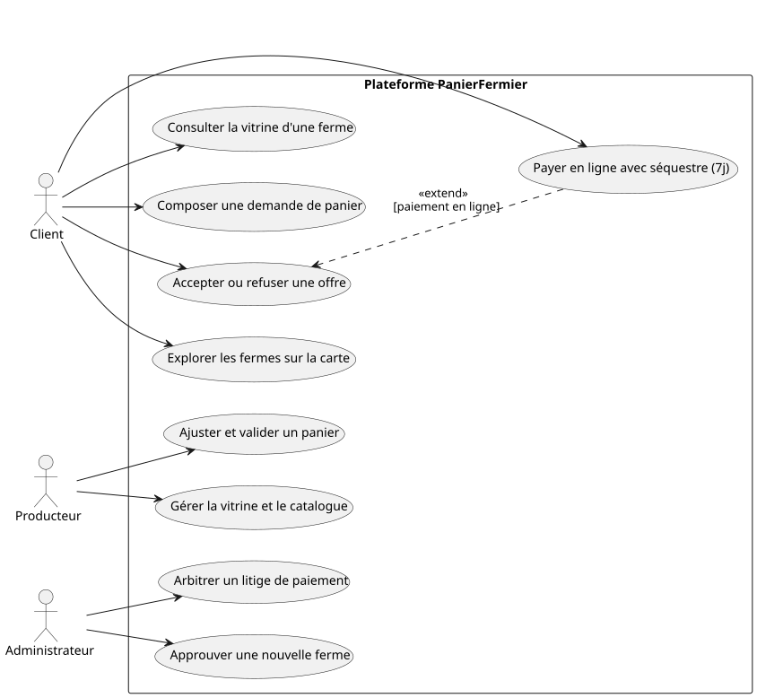

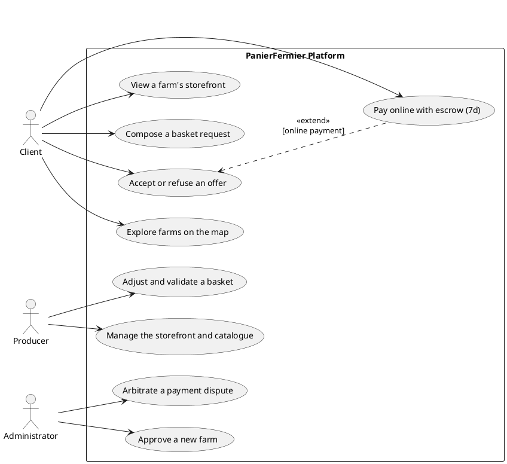

### 3.3. Conceptual UML Class Diagram (Domain Model)

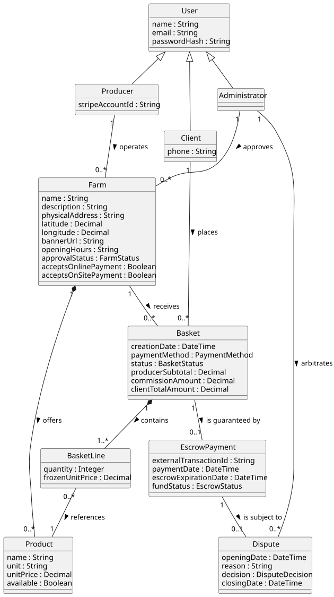

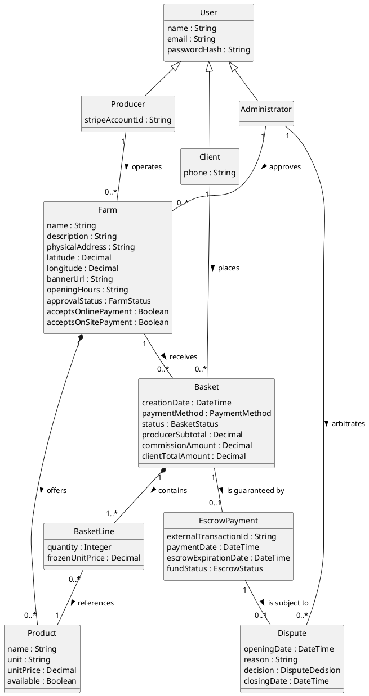

The model represents the central business concepts without technical implementation details. A `Producer` operates one or more `Farm`s, whose visibility depends on the `approvalStatus` validated by an `Administrator`. In accordance with the privacy requirement ([`C1-NF1`](#c1-nf1---privacy)), the `Client` class contains no postal address or geolocation attribute. Each `Basket` groups `BasketLine`s linked to the `Product`s of a single farm and gives rise, only in the case of online payment, to a 7-day `EscrowPayment` that can be blocked by a `Dispute` arbitrated by the `Administrator`.

## 4. Detailed Requirements

### 4.1. Functional Requirements

#### 4.1.1. Category 1 - Farm discovery and basket ordering (Client)

**Category description:** Consumers explore farms on a map, consult their products and compose baskets to be collected at the farm.

##### C1-F1 - Map exploration

| **ID** | `C1-F1` |
| --- | --- |
| **Name** | Map exploration |
| **Short description** | The system displays an interactive map allowing any visitor (no account required) to locate approved farms within the displayed geographical area. |

##### C1-F2 - Storefront consultation

| **ID** | `C1-F2` |
| --- | --- |
| **Name** | Storefront consultation |
| **Short description** | The system displays the public page of a farm including its banner photo, its description, its opening hours, its mandatory address, the list of products offered and the accepted payment methods. |

##### C1-F3 - Basket composition and payment

| **ID** | `C1-F3` |
| --- | --- |
| **Name** | Basket composition and payment |
| **Short description** | An authenticated client composes a basket from the products of a farm and chooses one of the payment methods authorised by that producer. |
| **Inputs** | Farm identifier, list of selected products with the desired quantities, chosen payment method (online payment on the platform or payment at the farm: Card, TWINT, Cash). |
| **Preconditions** | The client is logged into their account; the farm page is approved and visible; the basket contains at least one item. |
| **Rules / steps** | 1. The system verifies that all products come from one and the same farm. 2. The system restricts the payment choice to the options enabled by the producer ([`C2-F2`](#c2-f2---payment-methods)). 3. The system records the request with the status *"Pending producer validation"* and triggers a notification ([`C3-F2`](#c3-f2---order-notifications)). |
| **Outputs** | Basket request identifier and indicative estimate of the total amount. |
| **Acceptance criteria** | A valid basket is recorded in the database and transmitted to the relevant producer; any attempt to submit an empty basket or one with a payment method not authorised by the farm is rejected. |

##### C1-F4 - Offer acceptance or refusal

| **ID** | `C1-F4` |
| --- | --- |
| **Name** | Offer acceptance or refusal |
| **Short description** | The client reviews the basket validated or modified by the producer as well as the final proposed price, then decides whether to accept or reject the offer. |
| **Rules / constraints** | Accepting an offer firmly commits the client to collect their basket; no unilateral cancellation is authorised after confirmation. |
| **Acceptance criteria** | If the client rejects the offer, the request moves to the *"Cancelled"* status at no cost; if they accept with on-site payment, the order moves to the *"Confirmed"* status; if they accept with online payment, the escrow flow ([`C1-F5`](#c1-f5---guaranteed-online-payment)) is triggered. |
| **Model** | 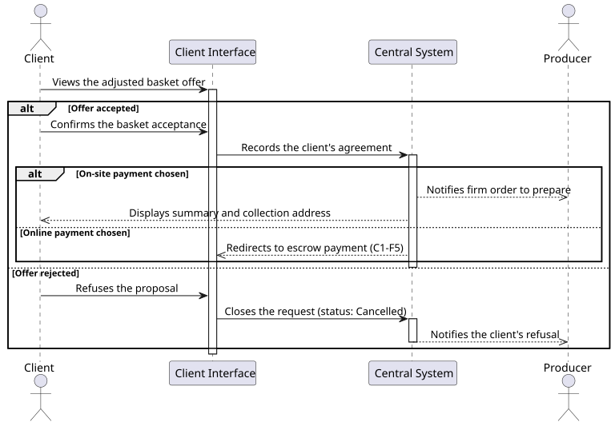 |

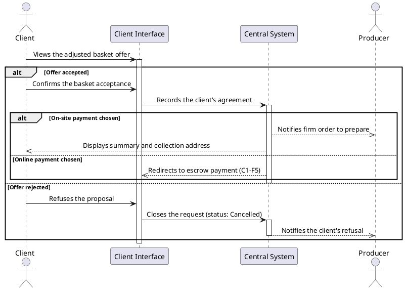

##### C1-F5 - Guaranteed online payment

| **ID** | `C1-F5` |
| --- | --- |
| **Name** | Guaranteed online payment |
| **Short description** | When the client opts for online payment and accepts the offer, they pay the amount increased by the fixed commission through the external payment intermediary's hosted module (e.g. Stripe), which holds the funds in escrow for 7 days. |
| **Inputs** | Accepted basket identifier, total amount including the fixed commission ([`C3-F3`](#c3-f3---price-and-commission-calculation)), token and confirmation (webhook) returned by the payment intermediary. |
| **Preconditions** | The producer has enabled online payment with a valid beneficiary account ([`C2-F2`](#c2-f2---payment-methods)) and validated the offer ([`C2-F5`](#c2-f5---basket-adjustment-and-offer)); the client has accepted the offer ([C1-F4](#c1-f4---offer-acceptance-or-refusal)). |
| **Rules / steps** | 1. The system creates a payment intent with the external intermediary's API with fund retention (escrow / deferred transfer for 7 days). 2. The client enters their payment details (Card or TWINT) exclusively on the provider's secure interface. 3. Upon receipt of the provider's confirmation, the order becomes firm and non-cancellable: the producer must prepare the basket and the client must come and collect it. |
| **Outputs** | External transaction identifier, payment receipt, escrow expiration date ($T_0 + 7\text{ days}$) and support contact details visible in case of dispute. |
| **Acceptance criteria** | Upon receipt of the payment intermediary's confirmation, the order status moves to *"In escrow (7d)"*, no banking data is stored on the platform, no cancellation button is available, and the producer receives the preparation order. |

#### 4.1.2. Category 2 - Storefront management and basket processing (Producer)

**Category description:** Agricultural producers create their storefront, define their sales conditions and adjust basket requests according to their real availability.

##### C2-F1 - Storefront creation

| **ID** | `C2-F1` |
| --- | --- |
| **Name** | Storefront creation |
| **Short description** | A registered producer creates their farm page by mandatorily entering the farm's physical address, a banner photo, a description and their opening hours; the page remains hidden from the public until administrative validation ([`C3-F1`](#c3-f1---farm-approval)). |

##### C2-F2 - Payment methods

| **ID** | `C2-F2` |
| --- | --- |
| **Name** | Payment methods |
| **Short description** | The producer selects the settlement methods they accept: online payment delegated through the platform's payment intermediary (requiring the association of a beneficiary account with the provider, such as Stripe Connect, with guarantee and fixed commission) and/or direct payment at the farm (Card, TWINT, Cash, with no fee and no guarantee). |

##### C2-F3 - Product catalogue

| **ID** | `C2-F3` |
| --- | --- |
| **Name** | Product catalogue |
| **Short description** | The producer adds, modifies or deletes available products (name, unit, unit price) on their storefront at any time, without ever having to enter or maintain stock quantities. |

##### C2-F4 - Storefront update

| **ID** | `C2-F4` |
| --- | --- |
| **Name** | Storefront update |
| **Short description** | Any update made by a producer to a page already validated by the administration is published instantly without a new manual approval. |
| **Inputs** | Modifications to the banner photo, the description, the opening hours, the product list or the payment methods. |
| **Preconditions** | The producer's account is authenticated and their storefront already has the *"Approved"* status. |
| **Rules / steps** | 1. The system validates the format of the modified fields (e.g. non-empty address, positive prices). 2. The system saves the new data and keeps the *"Approved"* status. 3. The storefront remains visible on the map without interruption. |
| **Outputs** | Save confirmation and immediate update of the farm's public page. |
| **Acceptance criteria** | When an approved producer modifies their opening hours or adds a product, the change is visible to a visitor in less than 5 seconds without any administrator intervention. |

##### C2-F5 - Basket adjustment and offer

| **ID** | `C2-F5` |
| --- | --- |
| **Name** | Basket adjustment and offer |
| **Short description** | Upon receiving a basket request, the producer may remove unavailable items and validate the final price automatically proposed by the platform. |
| **Inputs** | Basket request identifier, list of retained items (removal of missing items possible), confirmation of the calculated price. |
| **Preconditions** | A basket request with the *"Pending producer validation"* status exists for this farm. |
| **Rules / steps** | 1. The producer consults the requested basket and removes, where applicable, one or more unavailable products. 2. The system automatically recalculates the total price according to the retained items and the chosen payment method ([`C3-F3`](#c3-f3---price-and-commission-calculation)). 3. The producer validates this proposal, which moves the request to the *"Offer submitted to client"* status and notifies the buyer ([`C3-F2`](#c3-f2---order-notifications)). |
| **Outputs** | Updated basket, validated final price and notification sent to the client. |
| **Acceptance criteria** | The producer can remove a missing item from a requested basket, see the adjusted price recalculated automatically and forward the offer to the client; if all items are removed, the request is refused. |

#### 4.1.3. Category 3 - Administration, notifications and financial management (System & Admin)

**Category description:** The system automates notifications and commission calculations, while the administrator controls producer onboarding and arbitrates disputes.

##### C3-F1 - Farm approval

| ID | `C3-F1` |
| --- | --- |
| **Name** | Farm approval |
| **Short description** | An administrator reviews the newly created farm pages and manually validates their publication to make them visible on the map. |
| **Inputs** | Identifier of the pending farm, administrator's decision (Approve or Reject). |
| **Preconditions** | A producer has completed the initial creation of their storefront ([`C2-F1`](#c2-f1---storefront-creation)), which is in the "Pending approval" status (hidden from the public). |
| **Rules / steps** | 1. The administrator verifies the farm's authenticity and the validity of the entered address. 2. If the administrator approves the page, its status moves to *"Approved"* and its geographical coordinates appear immediately on the public map ([`C1-F1`](#c1-f1---map-exploration)). 3. In case of rejection, the storefront remains hidden and the producer is informed of the reason. |
| **Outputs** | Update of the farm's visibility on the platform. |
| **Acceptance criteria** | A newly created farm is invisible in client searches before validation and becomes publicly viewable as soon as an administrator clicks *"Approve"*. |

##### C3-F2 - Order notifications

| ID | `C3-F2` |
| --- | --- |
| **Name** | Order notifications |
| **Short description** | The system automatically sends a notification to the producer when a client creates a basket, then to the client when the producer validates or adjusts that basket. |

##### C3-F3 - Price and commission calculation

| ID | `C3-F3` |
| --- | --- |
| **Name** | Price and commission calculation |
| **Short description** | The system automatically calculates the basket price from the retained products, applying a fixed commission rate only when online payment is selected. |
| **Inputs** | List of retained products with their unit prices, chosen payment method, fixed commission rate configured on the platform. |
| **Rules / steps** | 1. The system calculates the products subtotal $S = \sum (\text{price}_i \times \text{quantity}_i)$. 2. If the payment method is *"Payment at the farm"*, the final amount equals $S$ (commission $= 0$). 3. If the payment method is *"Online payment"*, the final amount charged to the client is $M = S \times (1 + r)$, the share transferred to the producer being $S$. |
| **Outputs** | Producer subtotal ($S$), commission amount and client total price ($M$). |
| **Acceptance criteria** | For a 50 CHF basket and a fixed 10 % rate, the system displays 50 CHF with no fee for on-site payment and 55 CHF for online payment. |

##### C3-F4 - 7-day fund release

| **ID** | `C3-F4` |
| --- | --- |
| **Name** | 7-day fund release |
| **Short description** | If no dispute is opened within the 7 calendar days following an online payment, the system automatically sends, through the payment intermediary's API, the instruction to transfer the producer's share ($S$) to their beneficiary account and to collect the platform's fixed commission. |
| **Inputs** | List of orders in the *"In escrow (7d)"* status whose expiration date ($T_0 + 7\text{ days}$) has been reached and which have no open dispute ([`C3-F5`](#c3-f5---dispute-arbitration)). |
| **Preconditions** | The online payment has been confirmed ([`C1-F5`](#c1-f5---guaranteed-online-payment)), 7 calendar days ($168\text{ hours}$) have elapsed and no dispute has been recorded by an administrator. |
| **Rules / steps** | 1. A scheduled task periodically checks escrow payments that have reached their due date. 2. For each eligible order without an active dispute, the system calls the payment intermediary's API to trigger the transfer of the $S$ subtotal to the producer and to retain the commission. 3. Upon receipt of the provider's confirmation, the status moves to *"Funds released"*. |
| **Outputs** | API transfer order, payout identifier and update of the order status. |
| **Acceptance criteria** | Any order paid online without a dispute has its funds automatically released to the producer at the latest 1 hour after the expiry of the 7-day period, while any order with an open dispute is ignored by this process. |

##### C3-F5 - Dispute arbitration

| ID | `C3-F5` |
| --- | --- |
| **Name** | Dispute arbitration |
| **Short description** | When a client reports by e-mail or telephone (through the contact details displayed on the platform) that they were unable to obtain their online-paid basket within the 7-day period, the administrator suspends the automatic transfer and settles the dispute through the payment intermediary. |
| **Rules / constraints** | The administrator can only close a dispute with one of two mutually exclusive outcomes executed through the payment intermediary's API: (1) order a full refund to the client if the producer did not provide the basket as promised, or (2) order the release of the funds to the producer if the client did not show up while the producer fulfilled their obligations. |
| **Acceptance criteria** | Opening a dispute blocks the sending of the automatic transfer instruction ([`C3-F4`](#c3-f4---7-day-fund-release)); outcome (1) triggers a full refund from the provider (status *"Client refunded"*), while outcome (2) triggers the transfer to the producer's beneficiary account (status *"Funds released"*). |
| **Model** | 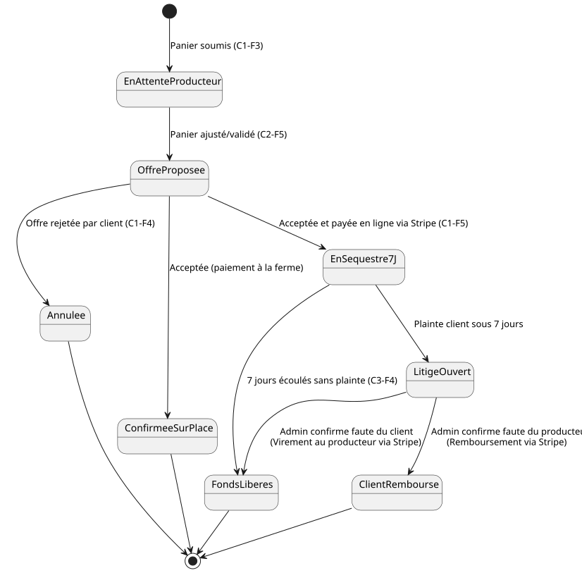 |

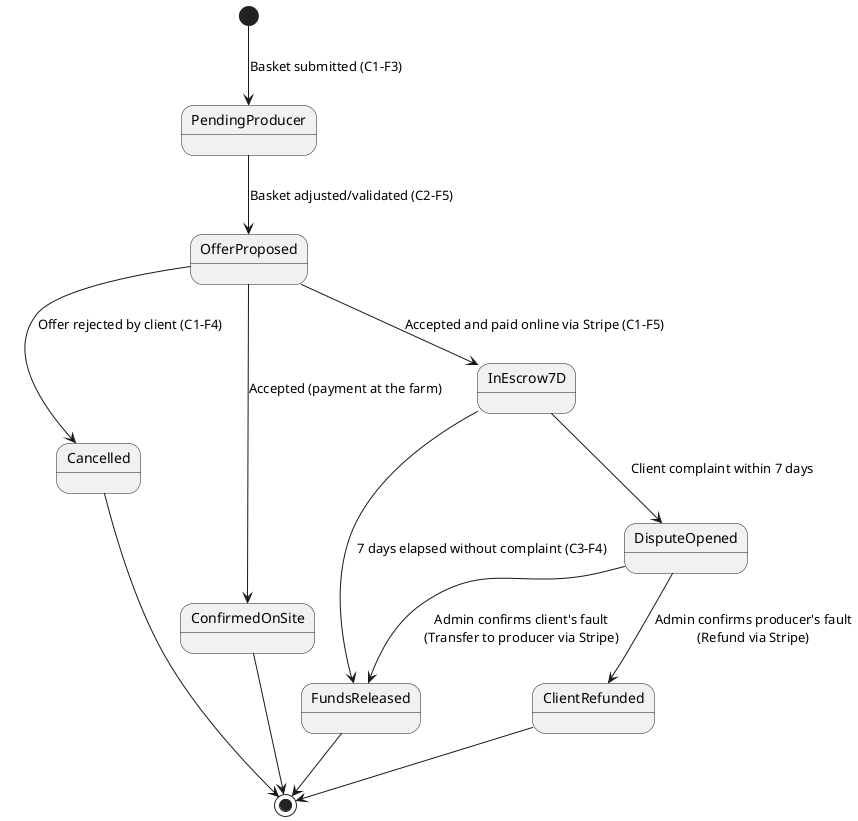

### 4.2. Non-Functional Requirements

Each non-functional requirement specifies measurable acceptance criteria together with the load or operating conditions.

#### 4.2.1. Category 1 - Privacy and Security

##### C1-NF1 - Privacy

| ID | `C1-NF1` |
| --- | --- |
| **Name** | Privacy |
| **Description** | The application must neither request access to the client device's GPS sensor nor store any personal postal address for consumers. |
| **Measurable acceptance criterion** | In an audit of network requests and of the database schema over 100 complete client sessions (map exploration and ordering), 0 GPS permissions are requested on the client side and 0 location data or personal buyer addresses are persisted on the servers. |

##### C1-NF2 - Payment security

| ID | `C1-NF2` |
| --- | --- |
| **Name** | Payment security |
| **Description** | All processing of online transactions (bank card, TWINT) as well as the temporary retention of funds during the 7-day escrow must be entirely delegated to a certified PCI-DSS external payment intermediary (such as Stripe), with no sensitive banking data transiting in clear text or being stored on the platform's servers. |
| **Measurable acceptance criterion** | In a technical and network audit covering 100 online transactions (Card and TWINT), 100 % of payment entries are made through the provider's hosted components (e.g. Stripe Checkout/Elements), 100 % of network exchanges use the TLS 1.3 protocol minimum, and 0 sensitive financial data (card number, CVV, bank identifier) is recorded in the platform's database. |

#### 4.2.2. Category 2 - Performance and Reliability

##### C2-NF1 - Map performance

| ID | `C2-NF1` |
| --- | --- |
| **Name** | Map performance |
| **Description** | The display of approved farms when panning or zooming on the interactive map must perform quickly under normal load. |
| **Measurable acceptance criterion** | At least 95 % of 1 000 geographical area loading requests complete in less than 1.5 seconds with 200 concurrent users on a database containing 1 000 registered farms. |

##### C2-NF2 - Notification delay

| ID | `C2-NF2` |
| --- | --- |
| **Name** | Notification delay |
| **Description** | Notifications upon basket submission or upon a counter-offer sent by the farmer must be delivered without noticeable delay. |
| **Measurable acceptance criterion** | 99 % of notifications (push/e-mail) are emitted by the server to the messaging service in less than 5 seconds after the triggering action, measured over a sample of 500 basket transitions. |

#### 4.2.3. Category 3 - Ergonomics

##### C3-NF1 - Storefront ergonomics

| ID | `C3-NF1` |
| --- | --- |
| **Name** | Storefront ergonomics |
| **Description** | The farmer interface must allow creating a storefront and adjusting a basket without prior training or complex data entry. |
| **Measurable acceptance criterion** | In a usability test conducted with 10 producers without assistance, at least 90 % of them manage to create a complete storefront with 5 products in less than 8 minutes, and to remove an item from a received basket in less than 30 seconds. |

## 5. System Architecture

### 5.1. Client–Server Architecture

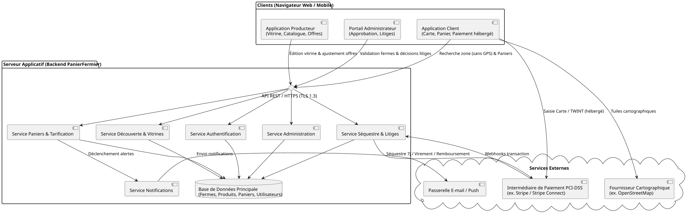

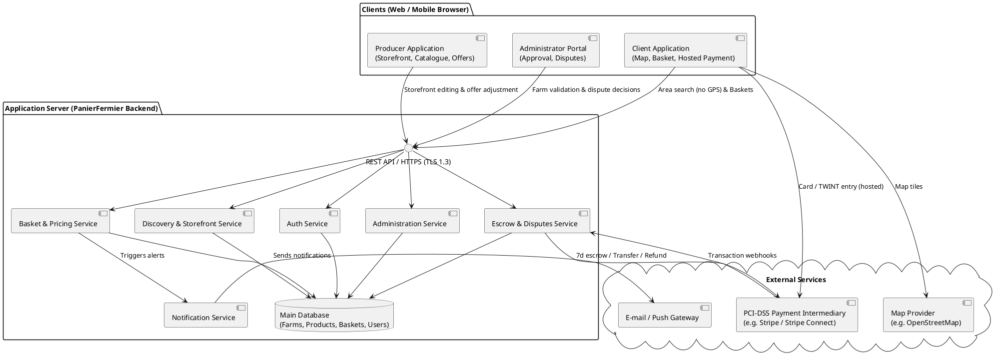

The architecture follows a decoupled client–server model. The **Client**, **Producer** and **Administrator** interfaces communicate with the application server exclusively through a **secured REST API (TLS 1.3)**. To comply with the security ([`C1-NF2`](#c1-nf2---payment-security)) and privacy ([`C1-NF1`](#c1-nf1---privacy)) requirements, the client application loads the map tiles directly without transmitting GPS coordinates to the server, and delegates payment detail entry to **Stripe**'s hosted components. On the server side, the business logic is divided into specialised services (authentication, discovery, pricing/baskets, escrow/disputes, administration and notifications) relying on a central relational database that stores neither sensitive banking data nor client addresses.
